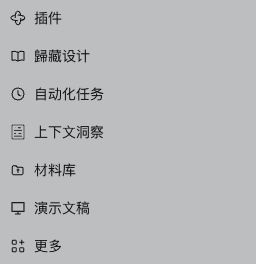
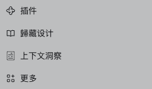
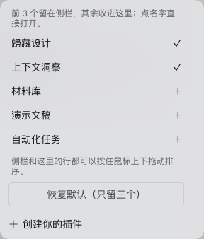

# dsh-panel-compact

DeepSeek Harness puts every plugin panel entry in the sidebar. When you install a handful of plugins, that list eats the top of the sidebar and squeezes the workspace below it. This plugin folds it down:

- **three entries stay** in the sidebar, the rest go into a **More** menu;
- the three that stay **can be dragged up and down with the mouse**;
- the More menu lists **every** panel: click a name to open it, use ✓/＋ to decide whether it lives in the sidebar or in More;
- your choice is remembered in `localStorage`, so the next launch looks the same.

| Before — every panel in the sidebar | After — three of them, plus More |
| --- | --- |
|  |  |



[中文说明](#中文说明)

## What it does

- **Folds the panel list.** Only the first three rows stay visible; the rest are hidden with `display: none` — no plugin is unloaded, nothing inside a panel changes.
- **Drag to reorder.** Press and drag any visible row; a 6 px threshold keeps a plain click working as "open this panel". Rows reorder live and the order is saved on release.
- **A real More menu.** The plugin fills the shell's `sidebar.panellist.actions` slot, which is what makes the shell render its "More" row in the first place. Every panel appears there, in your order, with a ✓ (in the sidebar) or ＋ (in More) toggle. Rows in the menu can be dragged too.
- **Click to open.** A name in the menu opens that panel and closes the menu.
- **Reset.** "Reset to the default three" restores the registration order and keeps the first three.
- **New panels are safe.** Install another plugin tomorrow and its entry lands in More automatically, without disturbing what you picked.

## Install

```sh
dsh plugin --profile <your-profile> add github:yingqi-studio/dsh-panel-compact
```

Also staged on npm as [`dsh-panel-compact`](https://www.npmjs.com/package/dsh-panel-compact) — the first release is in npm's staged review, so until it is approved the npm entry only carries the `0.0.0-stage` placeholder. Use the GitHub install above in the meantime; then `dsh plugin --profile <your-profile> add dsh-panel-compact` works too.

In DSH Desktop, open **Plugins**, search the name and install it there. **Restart the app** — a new bundle is composed into the profile tree at boot — and the sidebar comes back compact.

Requires the sidebar panel slots (`dsh.web` 0.2.x, verified against `@deepseek-ai/dsh-client-ui-sidebar` 0.2.1-rc.5). `engines.dsh` is declared as `>=0.2.0`.

## Why it is a browser-side plugin

The shell sorts panel rows by the `order` each plugin passed at registration, and exposes no API to reorder them; `setPinned` only reaches a plugin through the props of the `sidebar.panellist.actions` slot. So everything here happens in the page, on the row elements themselves:

- hidden rows get `style.display = 'none'`;
- order is `style.order` on `nav` children (`nav` is a flex column);
- every row is tagged with `data-dshsc-id` so a row can be mapped back to a panel id;
- when the number of rows and the number of registered panels disagree, rows fall back to label matching, and rows whose id cannot be resolved are left **visible**.

Two safety valves: if no "More" entry can be found, the plugin hides **nothing** (so panels can never be folded away with no way back); and the whole activation is wrapped in a `try/catch`, so a shell change degrades to "no compaction" instead of a broken sidebar.

The menu also hides the shell's own "Browse other plugins" row, since the full panel list is already there and the plugin browser is one click away in the sidebar.

## Where state lives

`localStorage['dsh-panel-compact.v1']`:

```json
{ "initialized": true,
  "order": ["plugins", "guizang-design", "schedules", "dsh-context", "materials", "dsh-ppt.workbench"],
  "pinned": ["guizang-design", "schedules"] }
```

Clear that key to go back to first-run behaviour. Note that this is per browser profile, not per DSH profile: two browsers see two layouts.

## Known limits

- The order is a CSS `order` on the DOM, so other plugins still see the registration order — nothing global is rewritten.
- The three visible rows count the always-present **插件 / Plugins** row, which is one of the three.
- It depends on the shell's DOM shape: a `nav` with class suffix `_panelList`, panel rows as `button[aria-label]`, and the More anchor as `button[aria-haspopup="menu"]`. That is why it is a plugin and not a core patch — if DSH changes the shell, this needs a matching change.
- Hiding is visual only: hidden rows are still mounted, and keyboard focus can still reach them behind the More row.

## Development

The plugin was verified against a real page, not a mock: copy the desktop profile to a scratch `DSH_HOME`, boot it with `dsh --profile test --no-open --port <port>`, then drive a Chromium instance over CDP and check the DOM (`display`, `order`, `data-dshsc-id`, `localStorage`) after pinning, dragging and resetting. `dsh --profile desktop --dump-config` confirms the bundle is composed into the profile tree as `- id: panel-compact / name: dsh-panel-compact`.

## 中文说明

DSH 左侧栏顶部的插件面板入口太多时，会把下面的工作区挤小。这个插件把这一排收起来：

- **只留三个**入口在侧栏，其余收进「更多」；
- 留下的三行**可以按住鼠标上下拖动排序**；
- 「更多」里列着全部面板：点名字直接打开，右边 ✓/＋ 决定它留在侧栏还是进更多；菜单里的行也能拖；
- 顺序和选择记在浏览器 `localStorage`，下次打开还是这样；
- 底部「恢复默认（只留三个）」一键回到初始状态；以后装了新插件，它的入口自动进「更多」，不打乱你已选好的。

安装：`dsh plugin --profile <你的profile> add dsh-panel-compact`，或在 DSH Desktop 的「插件」里搜名字安装，然后**重启应用**（新的 bundle 在启动时才会被合成进去）。

为什么是插件而不是改核心：外壳的面板行按注册时的 `order` 排序、没有对外排序 API，`setPinned` 也只在「更多」槽位的 props 里给到插件，所以显隐与顺序只能在浏览器里对行元素做（`display` / `order` / `data-dshsc-id`）。找不到「更多」入口时它什么也不藏，保证面板不会被藏了又打不开。

状态键：`localStorage['dsh-panel-compact.v1']`，清掉即恢复首次运行的状态。

MIT License.
